# Journal

## PCB designing

time taken: 1h 6m 1s

Designing PCB is fun, I js designed the pcb from the guide and later tomorrow I'm planning to convert it to a mini-keeb which can let me traverse through workspaces on my hyprland rice or js control music, I'm always open to ideas.\nI use arch btw:)

https://cdn.hackclub.com/01a03942-5b6f-7a40-afdb-92d1d3d9e873/hackpad-v1.kicad_pcb"

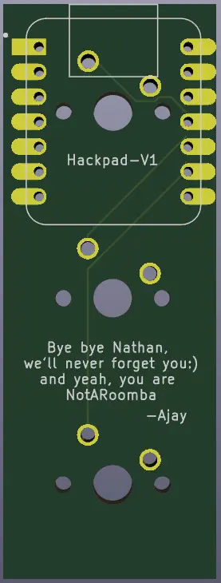      

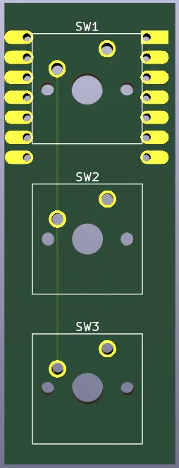

## FINALY FINISHED MY CAD AAAAA!!!!!!!!

time taken: 1h 29m 2s

after numerous crashes and cad software changes and driver issues, I finally completed my cad(basic), although I may improve this by adding a bluetooth module and/or a rotatory switch as I'm planning to control music this

#Blender is best

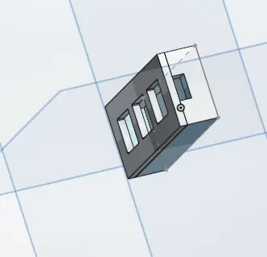

## Added a rotary switch

time taken: 36m 2s

so I spent………..idk like 45-60mins on reading the documentation and I've added and routed the rotary switch and now the major thing pending is just that I need to write or configure the firmware, until then bye bye!!

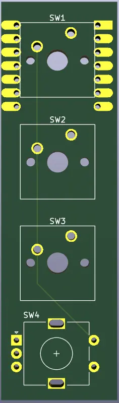

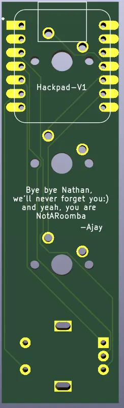

##  Firmware done yayayay

time taken: 36 56s

so i just completed the firmware for today, like reading the docs killed me, hence I did the most sensible decision: took a lil bit of help from AI, like i didn't want to drag this project for a loong time, but hey knowing python helped A LOT in understanding C. Ok that's all for now, the rest will prolly be js me submitting. Byee:)

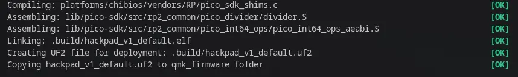

## Almost done

time taken: 1h 3m 45s

yayy I have completed the full project and pushed it to github, athough I have just the readme to complete, I guess I'll do it today, may the lord bless me with the motivation and knowledge for it.

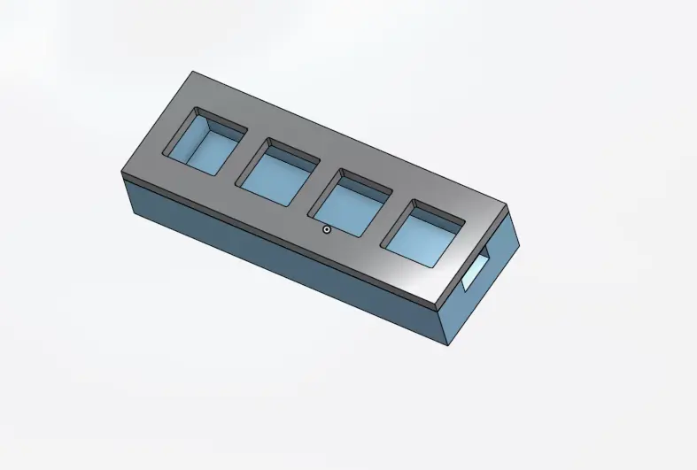

### things done:
- remodelled the case to fit my rotary encoder
- fixed sm issues in pcb
- comitted all the files to git

### things left to do:
- write README
- push to github 
- submit(yayayayay)

## PROJECT DONEE!!!!

time taken: 41m 29s

readme done, pushed to github, all done, only pending is that I need to submit, Imma submit bye!!

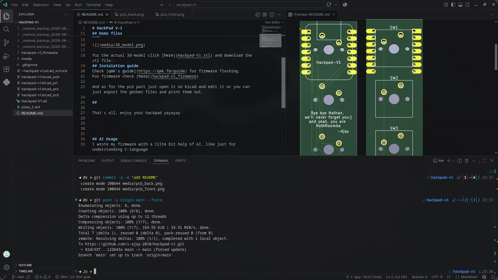

## Update

time taken: 53m 9s

I just updated the project's README to fit ship requirements and reorganized for the same, so yayy, how it gets approved:)
P.S.: `"minor changes"`
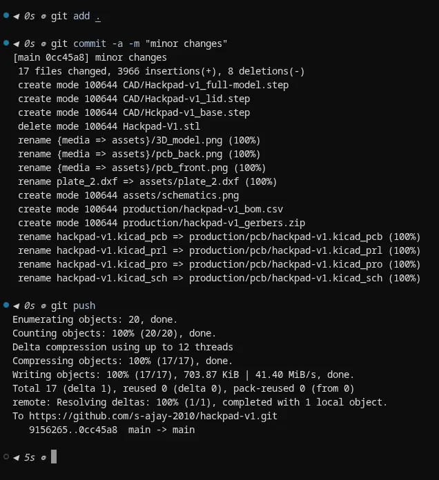

## BOM FIXEDD!!!!!!!!!!!! :prayge:

time taken: 19m 34s

so my BOM renders correctly now on github, yayy

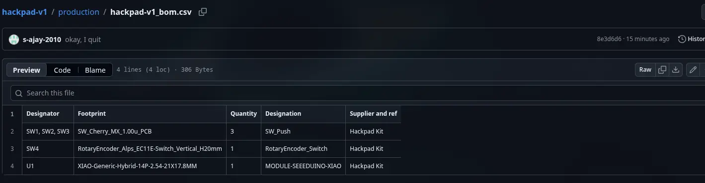

## Fixing issues

time taken: 39m 45s

Making a few last min changes for PCB making.
nahh yea this was for making a few changes and I had spent a day check and rechecking my PCB for it to get rejected by the manufacturer 2  two times and only then I got to know that I had to use another extension.

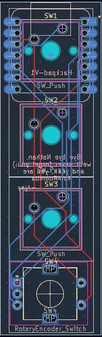

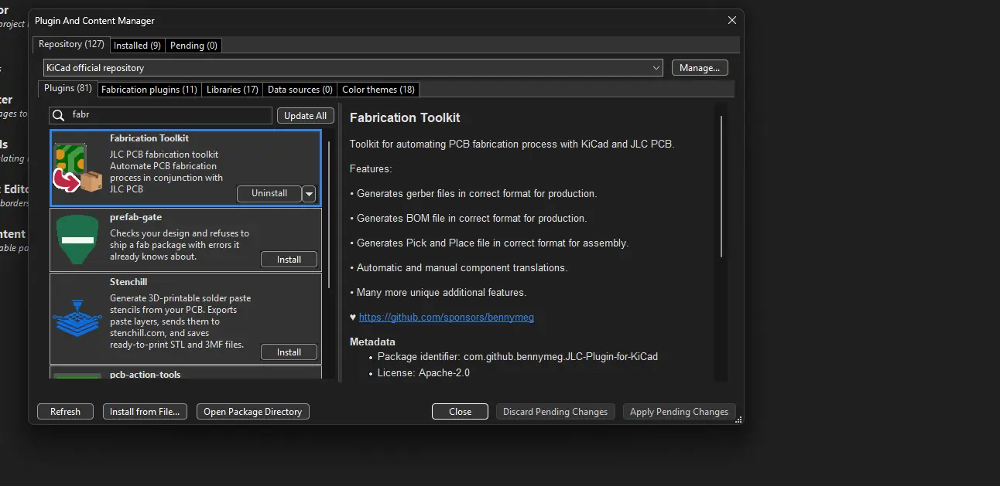

## CAD update

time taken: 55m 2s

updated the CAD
so my as per my last devlog I updated the PCB, but I forgot to update CAD and the CAD turned out to be with wrong measurements and now I updated CAD, once its done, we'll have the build video :yay:

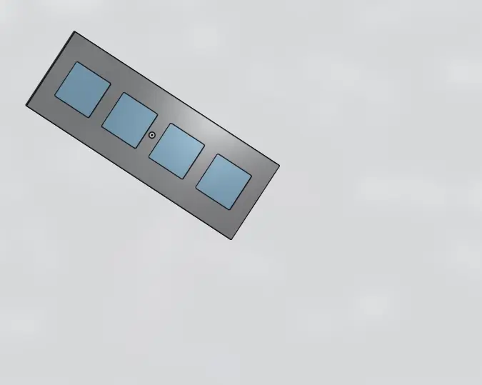

## Final!

time taken: 35m(ig not sure)

this is to conclude this project and to a final one bbefore submission:yay: